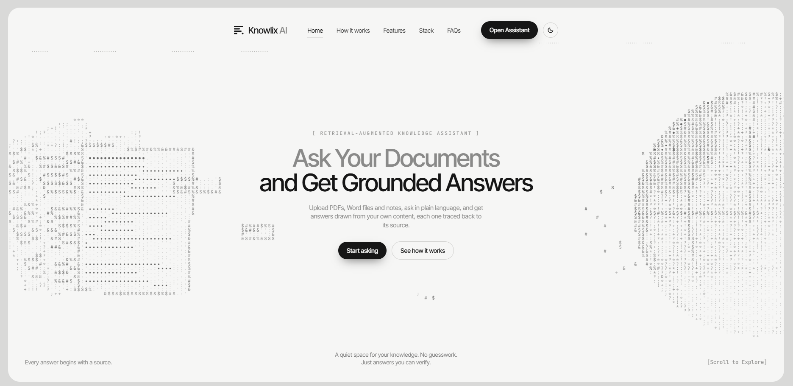
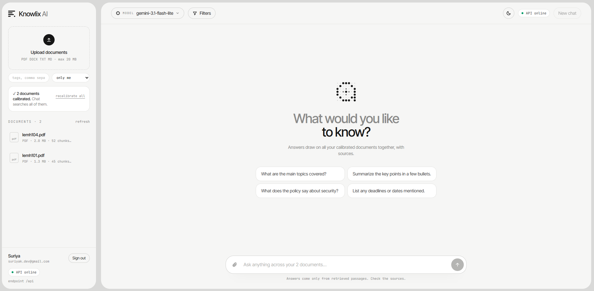

# Knowlix AI

> **[Read the Technical Design Document (PDF)](docs/Knowlix-AI-Technical-Design.pdf)**: how Knowlix AI works, explained for everyone, plus the full architecture, data model, retrieval pipeline, security, API reference, testing and roadmap (22 pages).

A retrieval-augmented knowledge assistant. Users upload PDFs, Word documents and notes, then ask questions in plain language. Answers are drawn only from passages the user is allowed to read, cite their sources, and are refused when the documents don't contain enough evidence.

## Screenshots

**Landing page:** monochrome design with an animated ASCII hero (documents breaking into chunks that stream into a vector-space globe).



**Assistant:** upload documents and calibrate them into the search index, choose the model (Gemini, Claude or OpenAI with your own key), and ask questions answered across all your documents with citations.



| | |
|---|---|
| [`backend/`](backend) | Python · FastAPI · Pydantic · async SQLAlchemy (PostgreSQL / SQLite) · Qdrant · FastEmbed · Claude / OpenAI / Gemini |
| [`frontend/`](frontend) | Next.js 16 · React 19 · Tailwind CSS v4 |
| [`docker-compose.yml`](docker-compose.yml) | PostgreSQL + Qdrant + API |

## Highlights

- **Ingestion pipeline:** parse (PDF/DOCX/TXT/MD) → clean → page-aware chunking → dense and sparse embeddings → Qdrant.
- **Hybrid retrieval:** semantic and BM25-style search fused with reciprocal rank fusion, then cross-encoder reranking.
- **Metadata filtering:** by document, file type and tags, enforced inside the vector search.
- **Grounded answers:** numbered citations that map to document, page and passage.
- **Refusals:** an evidence threshold before generation, and a refusal sentinel the LLM can return.
- **Auth and access control:** JWT login. Documents are private, shared with named users, or organization-wide, and every retrieval is filtered to what the user may read.

## Quick start

```bash
# Backend (SQLite + embedded Qdrant; no Docker needed)
cd backend
python -m venv .venv && .venv\Scripts\activate   # macOS/Linux: source .venv/bin/activate
pip install -r requirements-dev.txt
uvicorn app.main:app --reload                    # http://127.0.0.1:8000/docs

# Frontend (in another terminal)
cd frontend
npm install
echo NEXT_PUBLIC_API_MODE=live > .env.local      # omit for the in-browser demo
npm run dev                                      # http://localhost:3000
```

Production-like stack:

```bash
JWT_SECRET=$(python -c "import secrets; print(secrets.token_urlsafe(48))") docker compose up --build
```

See [`backend/README.md`](backend/README.md) for configuration, the API, tests and design notes, and [`frontend/README.md`](frontend/README.md) for the UI.

## Status

Implemented and tested:

- ingestion, hybrid retrieval, reranking, filtering, citations, refusals
- authentication and access control
- the web UI

Planned:

- RAG evaluation with Ragas and MLflow (benchmarks will be published once run)
- database migrations with Alembic
- a background job queue for ingestion
- streaming responses

## Author

**Suriya**, Software Engineer · AI Engineering
